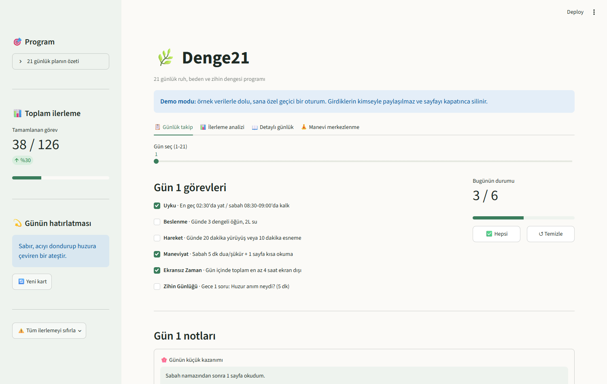
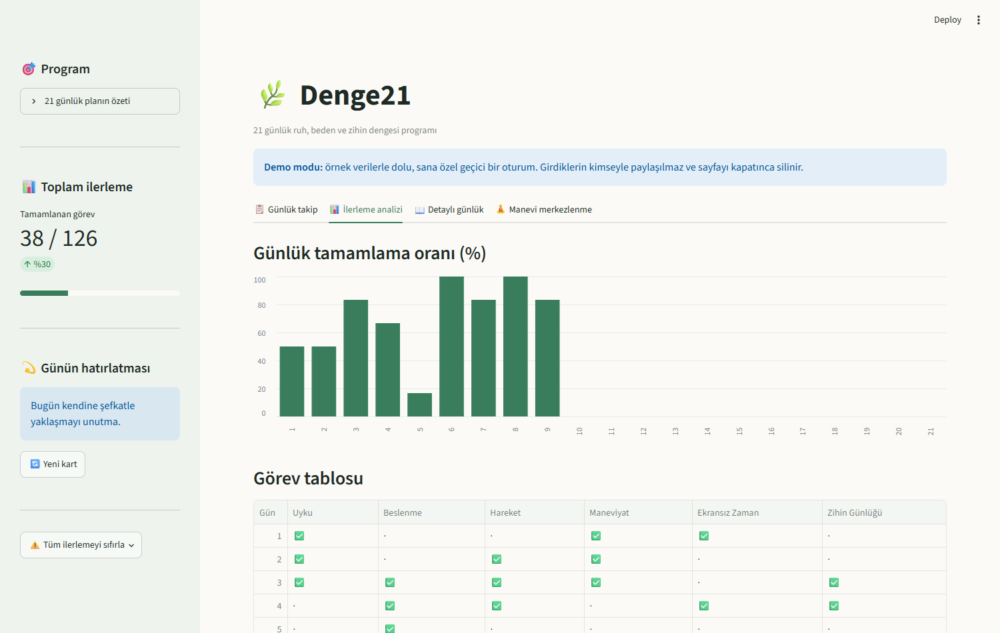

# 🌿 Denge21

**21 günlük alışkanlık, enerji ve günlük takip uygulaması** · Python + Streamlit + SQLite

> *English summary:* a local-first habit & journaling tracker for a 21-day
> wellbeing program. Daily checklist, energy log, sleep diary (with correct
> past-midnight sleep duration), weekly reflections, progress charts and CSV
> export. The program (days, tasks, cards) is defined in a single `config.py`,
> so it can be re-purposed for any challenge-style program. Includes a demo
> mode where every visitor gets an isolated, pre-seeded in-memory database.



## Hangi problemi çözüyor?

Alışkanlık uygulamalarının çoğu ya sadece "işaretle geç" listesidir ya da
abonelik ister. Denge21; görev takibini, enerji/uyku günlüğünü ve haftalık
refleksiyonu **tek ekranda**, **verin kendi bilgisayarında** kalacak şekilde
birleştirir. 21 günlük bir programı (ya da `config.py` ile tanımlayacağın
herhangi bir programı) günü gününe takip edip ilerlemeni grafiklerle görürsün.

## Özellikler

- ✅ **Günlük kontrol listesi:** her gün için görevler, "hepsi / temizle" kısayolları
- 🔋 **Enerji günlüğü:** sabah / öğle / akşam enerji seviyesi ve "günün küçük kazanımı"
- 💤 **Detaylı günlük:** uyku saatleri ve kalitesi, rutinler, niyet, şükür, gün sonu notu
- 📊 **İlerleme analizi:** günlük tamamlama oranı, görev tablosu, enerji seyri
- 📝 **Haftalık refleksiyon:** 7., 14. ve 21. günlerde kendini değerlendirme
- 📤 **CSV dışa aktarma:** tüm veriler Excel'de açılabilir şekilde (UTF-8 BOM)
- ⚙️ **Uyarlanabilir:** gün sayısı, görevler, evreler ve kartlar `config.py` içinde
- 🔒 **Yerel ve gizli:** veriler yerel bir SQLite dosyasında tutulur, hiçbir yere gönderilmez



## Kurulum

```bash
git clone https://github.com/idrishannn/denge21.git
cd denge21
python -m venv .venv
.venv\Scripts\activate          # macOS/Linux: source .venv/bin/activate
pip install -r requirements.txt
streamlit run app.py
```

Tarayıcıda `http://localhost:8501` açılır. Veriler proje klasöründeki
`denge21_plus_complete.db` dosyasına yazılır (bu dosya `.gitignore` içindedir).

### Demo modu

```bash
# Windows PowerShell
$env:DENGE21_DEMO="1"; streamlit run app.py
# macOS/Linux
DENGE21_DEMO=1 streamlit run app.py
```

Her ziyaretçi örnek verilerle dolu, **kendine ait geçici** bir veritabanı alır.
Canlı demo (Streamlit Community Cloud) bu modla çalışır, böylece ziyaretçiler
birbirinin verisini görmez.

### Ortam değişkenleri

| Değişken | Varsayılan | Açıklama |
|---|---|---|
| `DENGE21_DB` | `./denge21_plus_complete.db` | SQLite dosyasının yolu |
| `DENGE21_DEMO` | kapalı | `1` ise oturum başına bellek içi örnek veritabanı |

## Kendi programını tanımla

`config.py` dosyasını düzenle:

```python
PROGRAM_DAYS = 30
TASKS = [
    ("Kitap", "Günde 20 sayfa"),
    ("Spor", "30 dakika"),
]
```

Yeni bir görev eklediğinde eski kayıtların korunur, eksik satırlar otomatik eklenir.

## Proje yapısı

```
app.py        Streamlit arayüzü
db.py         SQLite veri katmanı (Streamlit'ten bağımsız, test edilebilir)
config.py     Program içeriği: günler, görevler, evreler, kartlar
tests/        pytest: veri katmanı + uygulama smoke testleri
```

## Testler

```bash
pip install -r requirements-dev.txt
pytest -q
```

Testler; gece yarısını geçen uyku süresi hesabını, SQL enjeksiyonuna karşı
parametreli sorguları, demo modunun diske yazmadığını ve uygulamanın boş bir
veritabanıyla açıldığını doğrular. GitHub Actions her push'ta testleri çalıştırır.

## Teknolojiler

Python 3.11 · Streamlit · pandas · SQLite · pytest · GitHub Actions

## Lisans

MIT
